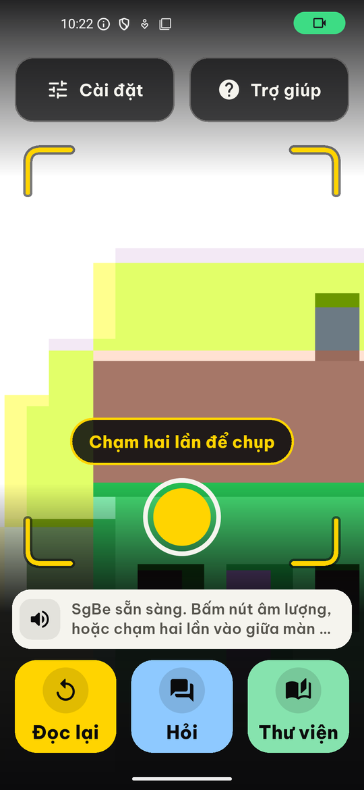
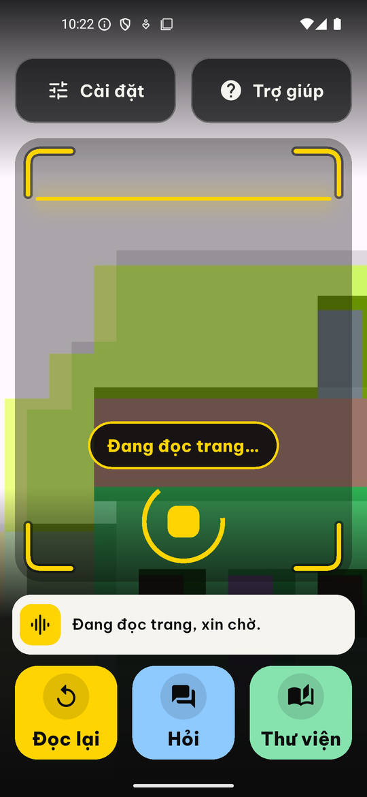
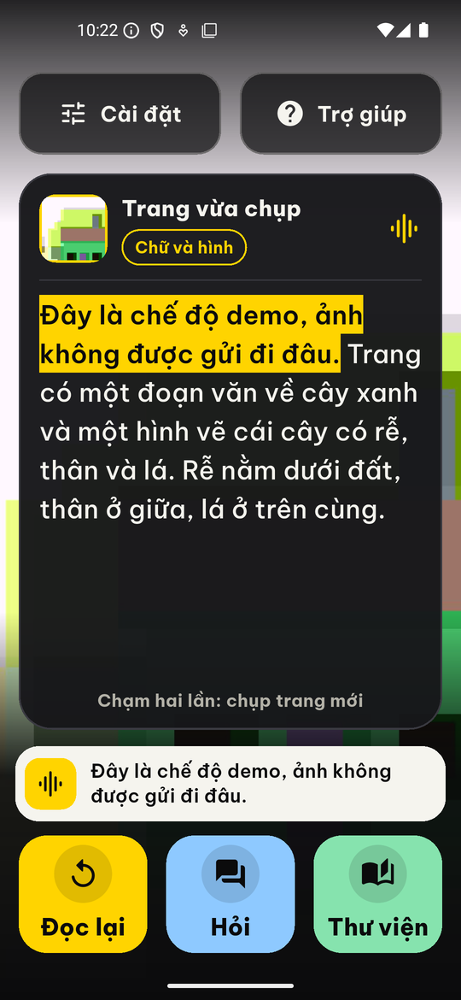
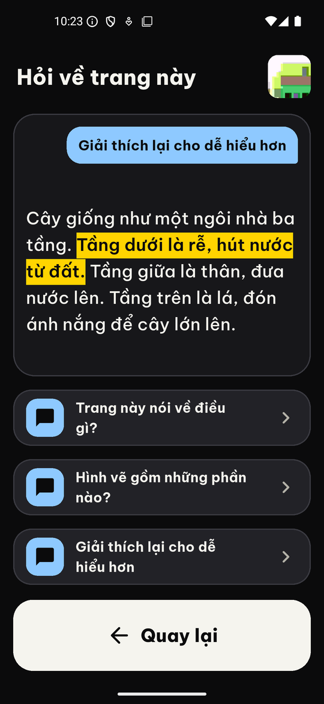
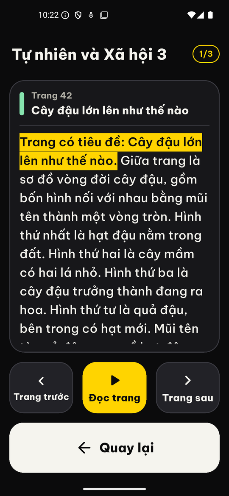
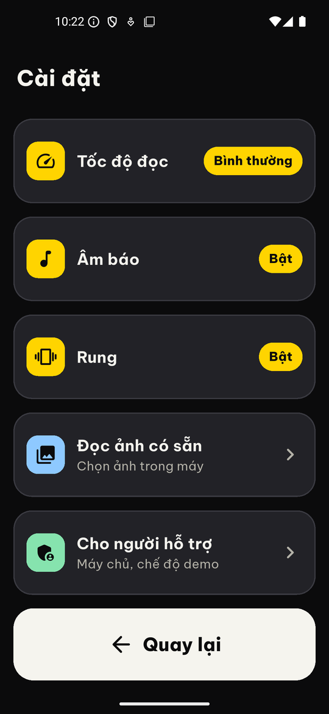

# SgBe — app Android

App Flutter cho học sinh khiếm thị: chụp trang sách, nghe mô tả bằng giọng tiếng Việt, hỏi thêm về trang, nghe sách đã số hóa. Người phụ trách: Toàn (Mảng C).

**Hợp đồng dữ liệu:** theo hợp đồng đầu ra AI v0.1 của Phúc (`../ai/contract/`): `status`, `summary_vi`, `interpretation_vi`, `image_type`, `question_answering_ready`, lỗi ở `status="error"` + `error`. App nhận cả kết quả gốc lẫn khi backend bọc trong `{data, error}`. Đọc được cả API v1 của Nam (`../docs/API_v1.md`). Gọi máy chủ qua `POST /v1/describe`, `POST /v1/ask`, `GET /v1/library`, `GET /health`. Trên nhánh `toan/tich-hop` app chạy thông với backend `VLM_MODE=ai` gọi module AI của Phúc: xem [`../docs/TICH_HOP.md`](../docs/TICH_HOP.md) (gồm ba điểm nghĩa đã thống nhất: `partial` = bị cắt ngắn, cổng chất lượng ảnh, cờ `question_answering_ready`).

| Màn hình chính | Đang đọc trang | Kết quả | Hỏi | Thư viện | Cài đặt |
|---|---|---|---|---|---|
|  |  |  |  |  |  |

Ảnh chụp từ máy ảo Android 15, bản release, chế độ demo (camera của máy ảo là cảnh giả).

## Chạy thử nhanh nhất (không cần điện thoại, không cần máy chủ)

```
flutter pub get
flutter test
```

Ngày 27/11/2026: 124 test đạt, 3 bỏ qua (cần backend thật). Gồm trợ năng tự động (nhãn TalkBack, vùng chạm, tương phản) trên mọi màn hình; cách thao tác chạm nghe / chạm hai lần / rê ngón / nhường TalkBack; không tràn chữ khi phóng chữ 200% và màn hình 360×640; đọc phản hồi thật của backend (`test/fixtures/`) và 4 ví dụ của hợp đồng AI v0.1 (`test/fixtures/contract_v01/`).

## Kiểm môi trường và dựng APK cho điện thoại

```
powershell -ExecutionPolicy Bypass -File tool\kiem_va_build.ps1
```

Script kiểm lần lượt Flutter, Android SDK, JDK, thiết bị đang cắm, `analyze`, `test`, rồi dựng APK release tách theo loại chip. Bước nào trượt thì dừng và nói cách sửa. Tham số:

- `-CaiLenMay`: build xong cài luôn lên điện thoại / máy ảo đang cắm (tự chọn đúng loại chip).
- `-Demo`: bật sẵn chế độ demo trong APK (không cần máy chủ).
- `-BoQuaTest`: bỏ bước analyze và test khi vừa chạy xong.

APK cho điện thoại thật: `build\app\outputs\flutter-apk\app-arm64-v8a-release.apk` (khoảng 19 MB). Bản release đang ký bằng khóa debug: đủ để cài thử, chưa đưa lên cửa hàng được.

## Chạy trên máy ảo hoặc điện thoại khi đang viết mã

1. Chạy máy chủ ở chế độ thử (xem `../README.md`), hoặc bỏ qua bước này và dùng chế độ demo.
2. Chạy app:
   ```
   flutter run                              # có máy chủ
   flutter run --dart-define=SGBE_DEMO=true # không có máy chủ: bật sẵn chế độ demo
   ```
3. Cài đặt → **Cho người hỗ trợ**:
   - Máy ảo Android: giữ địa chỉ mặc định `http://10.0.2.2:8000`.
   - Điện thoại thật cùng Wi-Fi: nhập IP LAN của laptop, ví dụ `http://192.168.1.15:8000`. Có thể phải mở cổng 8000 trên Windows Firewall.
   - Chạm **Kiểm tra kết nối**: app đọc to kết quả.

Điện thoại phải có dữ liệu giọng tiếng Việt: Cài đặt → Trợ năng → Chuyển văn bản thành giọng nói → Google → tải Tiếng Việt. Thiếu giọng, app báo bằng tiếng Anh và hiện nút mở cài đặt giọng.

## Thao tác

**Chạm một lần để nghe, chạm hai lần để dùng** — trên mọi màn hình, không cần bật TalkBack.

| Làm gì | Kết quả |
|---|---|
| Chạm một lần vào nút | Nghe tên nút (tiếng tách + rung nhẹ), nút được viền trắng |
| Chạm hai lần vào nút | Dùng nút |
| Giữ và rê ngón tay | Nghe tên từng nút đi qua |
| Chạm bất kỳ khi đang đọc | Dừng đọc |
| Nút âm lượng (màn hình chính) | Chụp ngay; đang đọc thì dừng |
| Bật TalkBack | App nhường cho TalkBack, thao tác như mọi app |

Bố cục cố định: **Cài đặt** góc trên trái, **Trợ giúp** góc trên phải, **vùng chụp** ở giữa (kết quả hiện tại chỗ), **Đọc lại / Hỏi / Thư viện** ở mép dưới. Màn hình con: **Quay lại** chiếm cả mép dưới.

Kịch bản đầy đủ: `docs/KICH_BAN_TUONG_TAC.md`. Yêu cầu giao diện: `docs/YEU_CAU_GIAO_DIEN.md`. Checklist trợ năng: `docs/CHECKLIST_TRO_NANG.md`.

## Hướng dẫn chụp (thêm 27/11/2026)

Ba lớp, hai lớp đầu chạy ngay trên máy, không cần mạng:

1. **Đang ngắm** (màn hình chụp): vài khung xem trước mỗi giây được đo **tối, chói, mờ, rung**. Chỉ nhắc khi lỗi kéo dài 3 khung (khoảng 1,2 giây), mỗi lần một lỗi quan trọng nhất, cùng một lỗi cách nhau ít nhất 6 giây; không chen khi app đang nói. Khung hình ổn thì chỉ phát một âm ngắn kèm rung nhẹ.
2. **Vừa chụp** (chỉ ảnh từ camera): ảnh hỏng rõ thì **chưa gửi**, app nói lý do và mời chụp lại. **Không bao giờ giữ hai lần liên tiếp**; bộ kiểm lỗi hoặc không chắc thì cho ảnh đi tiếp. Ảnh chọn từ thư viện máy không bị kiểm.
3. **Máy chủ**: cổng chất lượng của module AI và mô hình, như trước.

Tắt, bật ở Cài đặt → Cho người hỗ trợ → **Hướng dẫn chụp**. Khi tắt, app vẫn **đếm** lỗi để làm mốc so sánh. Số liệu chỉ là số đếm lưu trên máy (không lưu ảnh), hiện ngay dưới công tắc.

**Trạng thái:** có test tự động; **chưa build APK và chưa chạy trên máy ảo hay điện thoại**. Phần nối camera (`services/capture_source.dart`, đổi khung xem trước sang YUV420 và tạm ngừng luồng khi chụp) **không có test tự động**. **Ngưỡng chưa hiệu chỉnh** trên khung hình điện thoại, nhất là ngưỡng rung; chưa đo độ giật và pin. So với cổng máy chủ trên 121 ảnh có trên máy (phần lớn tổng hợp và ảnh Wikimedia, không phải ảnh chụp điện thoại): cùng kết luận 118 ảnh; 2 ảnh nền đen rõ nét được cho qua trong khi **máy chủ vẫn chặn**, 1 ảnh ở sát ngưỡng chói.

## Cấu trúc

```
lib/
  main.dart                 khởi động: nạp cài đặt, giọng đọc, lời hướng dẫn lần đầu
  app_services.dart         gom các dịch vụ; phản hồi chạm (âm, rung, đọc tên nút)
  strings.dart              MỌI câu app nói và chữ hiển thị — sửa văn phong ở đây
  api/                      gọi máy chủ (describe, ask, health), chế độ demo, kiểu dữ liệu
  reader/
    reader_controller.dart  luồng chụp → gửi → đọc từng câu → hỏi tiếp; không phụ thuộc giao diện
  capture/
    frame_quality.dart      đo tối, chói, mờ, rung từ ảnh xám
    photo_check.dart        kiểm ảnh vừa chụp trước khi gửi
    live_guide.dart         quyết định khi nào nhắc (chống nhắc liên tục)
    capture_coach.dart      nối khung xem trước với lời nhắc
  library/library_data.dart sách cho Thư viện: máy chủ → bản đã lưu → sách mẫu trong assets/library/
  services/
    capture_source.dart     camera trong app + chọn ảnh
    speech.dart             giọng đọc (flutter_tts, vi-VN) + phụ đề câu đang nói
    earcons.dart            6 âm báo + rung, tắt được trong Cài đặt
    settings_store.dart     cài đặt lưu trên máy
    platform_bridge.dart    nút âm lượng, mở cài đặt giọng đọc (nối sang MainActivity.kt)
  ui/
    explore.dart            lớp thao tác chạm nghe / chạm hai lần / rê ngón; tự tắt khi bật TalkBack
    widgets.dart            nút màu, nút góc, hàng, Quay lại, phụ đề, đoạn đọc tô vàng, khung góc
    home_screen.dart        màn hình chính (camera tràn màn hình, kết quả trong vùng chụp)
    ask_screen.dart         Hỏi
    library_screen.dart     Thư viện, đọc sách
    settings_screen.dart    Cài đặt, Cài đặt cho người hỗ trợ
    theme.dart              màu, phông
android/app/src/main/kotlin/vn/nckh/sgbe/MainActivity.kt   bắt nút âm lượng
android/app/proguard-rules.pro   luật giữ lớp cho bản release (thiếu thì app treo khi mở)
assets/audio/               âm báo, sinh bằng tool/tao_am_bao.py
assets/fonts/               Be Vietnam Pro (SIL OFL 1.1)
assets/library/             sách mẫu cho Thư viện
tool/                       sinh âm báo, sinh biểu tượng app, kiểm môi trường và dựng APK
test/                       test tự động + phản hồi thật của backend
docs/                       kịch bản tương tác, checklist trợ năng, yêu cầu giao diện, ảnh chụp màn hình
```

## Các quyết định thiết kế

Tham khảo Seeing AI, Lookout (Google), Be My Eyes / Be My AI, Envision:

- **Camera tràn màn hình, nút nổi trên hình** (Seeing AI, Envision); **bốn góc vàng ôm trang** (khung tài liệu của Lookout).
- **Phụ đề câu đang nói** dạng bong bóng có biểu tượng loa (Envision).
- **Đọc từng câu, tô vàng câu đang đọc** (công cụ đọc của Lookout).
- **Hỏi tiếp bằng giọng nói** trên ảnh vừa chụp (Ask more của Be My AI): nhận giọng nói có sẵn của Android, tiếng Việt, bấm nút âm lượng là nói.
- **Chạm nghe, chạm hai lần dùng** ngay trong app, không bắt bật TalkBack; bật TalkBack thì app nhường.
- **Màu vàng gạch dẫn đường** trên nền gần đen, tương phản trên 7:1; mỗi nút một màu nhưng luôn kèm biểu tượng và chữ.
- **Camera trong app** (gói `camera`), không mở app camera hệ thống: bước "Đồng ý / Chụp lại" khó dùng khi không nhìn.
- **Lỗi luôn đọc thành tiếng**, không dùng SnackBar. Lỗi của máy chủ đọc nguyên `error.message`.
- **Ảnh 1920×1080**: đủ nét cho chữ SGK, thường dưới giới hạn 10 MB của máy chủ.

## Chưa làm

- Hướng dẫn chụp: canh khung (chữ chạm mép, 4 góc trang giấy), tự chụp; hiệu chỉnh ngưỡng trên điện thoại thật; thử cùng TalkBack và với người khiếm thị; đo tỉ lệ ảnh hỏng khi tắt và khi bật.
- Luồng "mô tả ngắn rồi hỏi người dùng muốn gì" (xem Quy cách đầu ra ở `../ai/README.md`): app vẫn đọc toàn bộ mô tả như trước.

- Khóa ký riêng cho bản phát hành.
